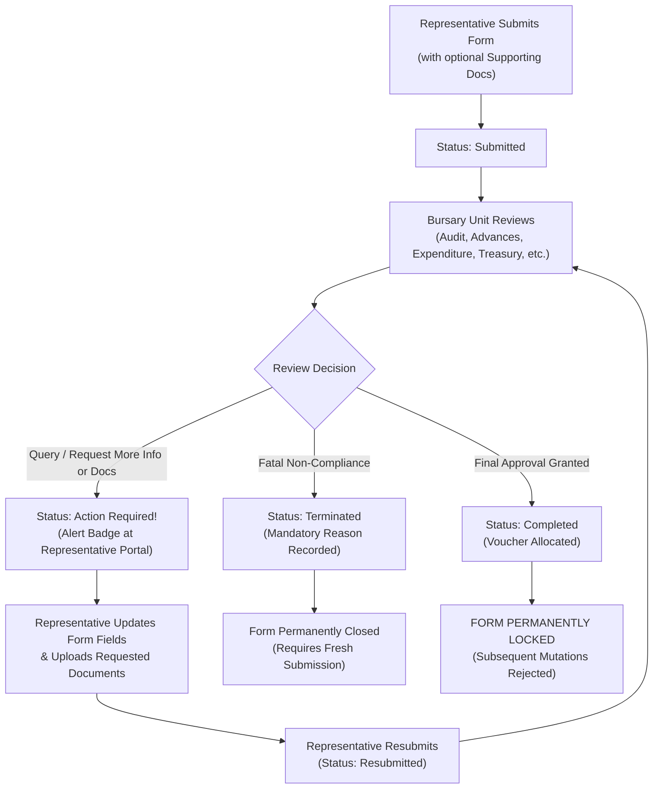

# Implementation Plan: BFF Architecture, Mock Database, User Management & Multi-Stage Bursary Review Workflow

## 1. Executive Summary & Architectural Vision

This implementation plan details the end-to-end architecture and execution roadmap for the **OAU Bursary Digital Form Submission & Processing System**. It incorporates a **Backend-For-Frontend (BFF)** architecture, an in-memory **Mock Database Layer with snapshot persistence**, an institutional **User Management System** with single & bulk Excel onboarding, a **Multi-Unit Bursary Review & Approval Workflow** with query loops and terminal locks, a **Site-wide Audit Log**, universal **Collapsible Sidebar Navigation**, and **Server-Side Data Tables** across all portals.

```
┌────────────────────────────────────────────────────────────────────────────────────────┐
│                              RESPONSIVE PRESENTATION LAYER                             │
│  Superadmin Portal         │  Representative Portal         │  Bursary Management      │
│  - User Management         │  - Form Submission + Docs      │  - Multi-Unit Review     │
│  - Excel Bulk Onboarding   │  - "Action Required!" Resubmit │  - Query / Resubmit Loop │
│  - Site-Wide Audit Logs    │  - Server-Side Table & Timeline│  - Final Approval & Lock │
│  - Collapsible Sidebar     │  - Collapsible Sidebar         │  - Terminate with Reason │
└───────────────────────────────────────────┬────────────────────────────────────────────┘
                                            │ HTTP / JSON (Server-side Search, Filter, Page)
┌───────────────────────────────────────────▼────────────────────────────────────────────┐
│                       BFF LAYER (Next.js 15 App Route Handlers)                        │
│   /api/auth/*    │    /api/users/*    │   /api/org-units/*   │   /api/submissions/*    │
│   /api/audit-logs/* (Superadmin Only) │   /api/uploads/*     │   /api/notifications/*  │
│  - @oauife.edu.ng Validation - Role & Route Guards - Zod Validation - Audit Dispatcher │
└───────────────────────────────────────────┬────────────────────────────────────────────┘
                                            │ Repository Interfaces
┌───────────────────────────────────────────▼────────────────────────────────────────────┐
│                            DATA ABSTRACTION LAYER                                      │
│  IUserRepository  │  IOrgUnitRepository  │  ISubmissionRepository  │  IAuditLogRepository│
├────────────────────────────────────────────────────────────────────────────────────────┤
│  [NOW] In-Memory Mock Store with JSON snapshot persistence (.data/mock-db.json)         │
│  [LATER] PostgreSQL Adapter (Prisma / Drizzle / pg pool)                                │
└────────────────────────────────────────────────────────────────────────────────────────┘
```

---

## 2. Core Entities & Data Modeling

### 2.1 University Organizational Units (`OrgUnit`)
Models all university entities eligible for a designated representative:
- **`unitType`**: `'faculty' | 'department' | 'directorate' | 'unit' | 'division'`
- **Fields**:
  - `id`: Unique string (e.g. `org-csc-dept`, `org-tech-faculty`, `org-dict-dir`, `org-works-div`)
  - `name`: Full entity name (e.g. "Department of Computer Science and Engineering")
  - `code`: Short code (e.g. "CSC")
  - `type`: UnitType
  - `parentUnitId`: Optional parent ID (e.g. Computer Science parent is Faculty of Technology)
  - `currentRepresentativeId`: User ID of currently active representative
  - `status`: `'active' | 'inactive'`
  - `createdAt`, `updatedAt`

### 2.2 User Hierarchy & Roles (`User`)
- **Roles**:
  1. `'superadmin'`: Full system control, representative onboarding, Bursary management configuration, site-wide audit log access, password resets.
  2. `'representative'`: Designated official representing an organizational unit. Submits forms, uploads supporting documents, resolves "Action Required!" queries, and tracks review progress.
  3. `'management'`: Bursary officers assigned to specific Bursary processing units (e.g. Internal Audit, Advances & Claims, Expenditure Control, Treasury, Final Accounts).
- **Institutional Email Validation**:
  - Enforced format: `^[a-zA-Z0-9._%+-]+@oauife\.edu\.ng$` (case-insensitive, verified in Zod schemas and server handlers).
- **Fields**:
  - `id`: UUID
  - `name`: Full staff name
  - `email`: Institutional email (`@oauife.edu.ng`)
  - `phone`: Contact phone number
  - `staffNumber`: University staff payroll / ID number
  - `role`: `'superadmin' | 'representative' | 'management'`
  - `orgUnitId`: Linked OrgUnit (for representatives)
  - `bursaryUnit`: Specific Bursary unit (for management users)
  - `status`: `'active' | 'deactivated'`
  - `mustChangePassword`: Boolean flag (initially `true`)
  - `passwordHash`: Salted/hashed password string
  - `createdAt`, `updatedAt`, `deactivatedAt`, `deactivationReason`

### 2.3 Supporting Documents Model (`SupportingDocument`)
All forms feature an optional multi-document attachment capability:
- `id`: UUID
- `fileName`: Original file name (e.g. `Invoice_Vendor_2026.pdf`)
- `fileSize`: Number of bytes
- `fileType`: MIME type (`application/pdf`, `image/png`, `image/jpeg`, etc.)
- `fileUrl`: Mock/Storage URL or base64 preview
- `uploadedAt`: ISO timestamp
- `uploadedBy`: User ID

### 2.4 Form Submissions & Review Workflow (`FormSubmission` & `ReviewComment`)
- **Enhanced Status Lifecycle**:
  ```
  Submitted ➔ In Review ➔ Action Required! (Query Raised) ➔ Resubmitted (Updated) ➔ In Review ➔ Completed (Locked)
                                                                                  └──> Terminated (Closed with Reason)
  ```
- **Statuses**:
  - `'Submitted'`: Initial submission by representative.
  - `'In Review'`: Being evaluated by one or more Bursary units.
  - `'Action Required'`: A Bursary reviewer has queried the response, requesting additional details or supporting documents. The representative is notified and edit/upload capabilities are unlocked.
  - `'Resubmitted'`: The representative has fulfilled the requested updates and resubmitted. Reviewers are notified.
  - `'Completed'`: Final authorization granted, voucher/mandate allocated, and **the entire form response is permanently locked**.
  - `'Terminated'`: Form response was rejected/disallowed with a **mandatory written explanation**. Cannot be updated; representative must submit a fresh application.
- **Fields**:
  - `id`, `referenceNumber`, `formType`, `applicantName`, `department`, `departmentId`, `submittedDate`
  - `status`: `'Submitted' | 'In Review' | 'Action Required' | 'Resubmitted' | 'Completed' | 'Terminated'`
  - `isLocked`: Boolean (true only when `status === 'Completed'`)
  - `formData`: Record containing specific form fields
  - `supportingDocuments`: Array of `SupportingDocument`
  - `voucherNumber?`: Assigned upon completion
  - `actionRequiredNotice?`: `{ requestedBy: string; unit: string; instructions: string; requestedAt: string }`
  - `resubmissionNote?`: Note supplied by representative upon resolving queries
  - `terminationReason?`: Mandatory explanation if terminated
  - `completedAt?`, `completedBy?`, `terminatedAt?`, `terminatedBy?`

### 2.5 Site-Wide Audit Log Model (`AuditLog`)
Accessible **exclusively to Superadmin** to provide forensic traceability:
- `id`: UUID
- `actorId`: User ID who initiated the event
- `actorName`: Full name of user
- `actorEmail`: Institutional email (`@oauife.edu.ng`)
- `actorRole`: Role of user (`superadmin` | `representative` | `management`)
- `action`: Standardized event code, e.g.:
  - `USER_LOGIN_SUCCESS`, `USER_LOGIN_FAILED`, `PASSWORD_CHANGED`, `PASSWORD_RESET_ADMIN`
  - `REPRESENTATIVE_CREATED`, `REPRESENTATIVE_UPDATED`, `REPRESENTATIVE_DEACTIVATED`, `REPRESENTATIVE_REPLACED`
  - `EXCEL_BULK_UPLOAD_COMPLETED`
  - `FORM_SUBMITTED`, `FORM_ACTION_REQUIRED_FLAGGED`, `FORM_UPDATED_RESUBMITTED`
  - `REVIEW_COMMENT_POSTED`, `FORM_APPROVED_LOCKED`, `FORM_TERMINATED`
- `entityType`: `'user' | 'org_unit' | 'submission' | 'auth'`
- `entityId`: Identifier of the target record
- `details`: Human-readable description & structured metadata (before/after changes)
- `ipAddress`: Request IP address
- `userAgent`: Client browser/device
- `timestamp`: ISO 8601 string

---

## 3. Institutional Authentication & Password Policies

1. **Strict `@oauife.edu.ng` Domain Enforcement**:
   - Both client-side Zod validation and server-side route handlers reject any non-institutional email.
2. **First-Time Login Forced Password Change**:
   - Accounts are created with an initial default password (`OAU-bursary2026!`) and `mustChangePassword: true`.
   - On login, if `mustChangePassword === true`:
     - User session is marked pending password update.
     - Global route guard immediately redirects to `/change-password` and prevents access to any portal route.
     - User must supply current password, new strong password (minimum 8 characters, uppercase, lowercase, number, symbol), and confirmation.
     - Upon successful submission, `mustChangePassword` is set to `false`, an audit log is written, and user enters their portal.
3. **Password Reset Capabilities**:
   - **Superadmin One-Click Reset**: Superadmin can reset any user's password to default, setting `mustChangePassword: true` and dispatching an audit log.
   - **Self-Service Reset Simulation**: User enters institutional email on `/forgot-password`, receives a simulated reset token, and completes reset via `/reset-password?token=...`.

---

## 4. User Management: Single, Excel Bulk Onboarding & Redeployment

### 4.1 Single Representative Registration
- Path: `/admin/representatives/new`
- Form fields:
  - Unit Category (`Faculty`, `Department`, `Directorate`, `Unit`, `Division`)
  - Target Unit Selector (filtered dynamically by category)
  - Full Name, Staff Number, Phone Number, Institutional Email (`@oauife.edu.ng`), Official Designation
- Assigns default password, marks `mustChangePassword: true`, binds unit, and logs `REPRESENTATIVE_CREATED`.

### 4.2 Excel Bulk Onboarding (`xlsx`)
- Path: `/admin/representatives/upload`
- **Downloadable Sample Template**:
  - Superadmin can download `OAU_Representatives_Template.xlsx` with strict headers:
    `[Full Name, Staff Number, Phone Number, Institutional Email, Unit Type, Unit Name, Unit Code, Designation]`
- **Upload & Interactive Validation**:
  1. Superadmin uploads `.xlsx` or `.csv` file.
  2. Server BFF (`POST /api/users/bulk-upload`) validates every row:
     - Checks email syntax (`@oauife.edu.ng`).
     - Detects duplicate emails in database and within the file.
     - Matches or auto-creates organizational units.
  3. Interactive Pre-Commit Table:
     - Displays valid records (green checkmarks) vs invalid records (red badges with exact error messages).
  4. Superadmin clicks "Commit Valid Records" to batch insert accounts and log `EXCEL_BULK_UPLOAD_COMPLETED`.

### 4.3 Redeployment & Deactivation
- In university administration, representatives get redeployed.
- Superadmin actions:
  - **Deactivate**: Sets status to `deactivated`, frees the organizational unit for a replacement, preserves past submissions linked to this representative.
  - **Replace Representative**: Modal allowing the superadmin to designate the incoming representative, automatically deactivating the outgoing representative and transferring active unit jurisdiction while preserving historic audit trails.

---

## 5. Multi-Unit Review, "Action Required!" Loop & Terminal Lock Workflow



### 5.1 The "Action Required!" Query & Resubmit Loop
1. When a Bursary unit reviewer requires corrections, additional details, or supplementary documentation:
   - Reviewer clicks **"Request Action / Information"**.
   - Reviewer specifies the exact instructions/query (e.g., "Please attach the signed departmental board approval and update the budget line item").
   - Status changes to `'Action Required'`.
   - Audit log and review comment are saved.
2. Representative Portal:
   - Submission displays a prominent yellow/amber alert badge: **"Action Required!"**.
   - An "Update & Resubmit" drawer/mode opens, displaying reviewer instructions.
   - Form inputs and the supporting document uploader become editable.
   - Representative modifies fields, uploads additional documents, inputs a resubmission note, and clicks **"Submit Updates"**.
   - Status transitions to `'Resubmitted'` (and back into the Bursary review queue).
   - Bursary reviewers receive an in-app banner that updates have been supplied.

### 5.2 Termination (Permanent Failure)
- If the form response cannot be processed, an officer selects **"Terminate Submission"**.
- **Enforced Rule**: A detailed failure reason is **mandatory** (minimum 15 characters).
- Form transitions to `'Terminated'` and is permanently closed.
- The representative can view the detailed termination reason. **Terminated forms cannot be edited or resubmitted**; the representative must initiate a new, clean submission.

### 5.3 Final Completion & Permanent Locking
- Authorized Bursary officer enters voucher/payment mandate details and clicks **"Approve & Complete"**.
- Status transitions to `'Completed'` and `isLocked = true`.
- **Enforced Rule**: All subsequent edit, review, comment, or status mutation requests are rejected with HTTP 403 Forbidden.
- The completed form displays a locked seal and is ready for native printing or PDF export.

---

## 6. Optional Supporting Documents for All Forms

Every department form includes an optional **Supporting Documents Upload Section**:
- Forms:
  1. Cash Advance Form
  2. DLPO Form
  3. Expenditure Authorization Form
  4. Duty Mileage Claim Form
  5. Imprest Holder Form
- Component Features:
  - Drag-and-drop file uploader accepting PDF, PNG, JPG, and DOCX files.
  - File size validation (up to 10MB per file) and file type verification.
  - Multi-file attachment with real-time list showing file name, formatted size, and remove button.
  - Displayed prominently in submission details view with download/preview triggers.
  - Re-accessible during the "Action Required!" loop to attach additional requested files.

---

## 7. Universal Collapsible Sidebar Navigation & Mobile Responsiveness

A shared, accessible navigation component (`AppSidebar`) implemented across all portals:
1. **Collapsible Desktop Mode**:
   - Expandable / Collapsible toggle button.
   - **Expanded**: Displays full portal branding, user profile card, section headings, navigation icons with text labels, and notification badges.
   - **Collapsed**: Smooth transition to icon-only mini sidebar with floating tooltip hovers for optimal screen space utilization.
   - State persisted in user preferences/cookies.
2. **Mobile & Tablet Drawer**:
   - Header with university seal and responsive hamburger menu.
   - Smooth slide-out mobile drawer / sheet using Radix Sheet.
   - Closes automatically upon route navigation.
3. **Portal-Specific Menus**:
   - **Superadmin Portal (`/admin/*`)**: Dashboard, Representatives, Organizational Units, Bursary Units, Site-Wide Audit Logs.
   - **Representative Portal (`/department/*`)**: Available Forms, My Submissions, Submission Tracking.
   - **Bursary Management Portal (`/bursary/*`)**: Overview Dashboard, Cash Advance, DLPO, Expenditure Auth, Duty Mileage, Imprest Holder, Review Queue.

---

## 8. Server-Side Data Tables (Search, Filter, Pagination)

To ensure performance with large datasets, **all tabular list views** utilize server-side query processing powered by TanStack Table and the BFF API:
- Query Parameters:
  `?page=1&limit=10&search=<term>&status=<status>&category=<category>&sortBy=<field>&sortOrder=<asc|desc>`
- Standardized Paginated Response:
  ```json
  {
    "data": [...],
    "pagination": {
      "page": 1,
      "limit": 10,
      "totalRecords": 142,
      "totalPages": 15,
      "hasNextPage": true,
      "hasPrevPage": false
    }
  }
  ```
- Views Utilizing Server-Side Tables:
  1. `/department/submissions`: Representative submissions list.
  2. `/bursary/[category]`: Bursary submissions tables by form type and review queue.
  3. `/admin/representatives`: Superadmin representative management table.
  4. `/admin/org-units`: University organizational units directory.
  5. `/admin/audit-logs`: Site-wide audit logs table.

---

## 9. Site-Wide Audit Log (Superadmin Exclusive)

- Path: `/admin/audit-logs`
- Guarded: Accessible **only** to users with `role === 'superadmin'`.
- UI Features:
  - Metric cards: Total audit events, user logins today, security events, form lifecycle changes.
  - Server-side filter bar:
    - Search by actor name, email, or entity ID.
    - Filter by Event Action (`USER_LOGIN`, `REPRESENTATIVE_REPLACED`, `FORM_TERMINATED`, etc.).
    - Filter by Entity Type (`user`, `org_unit`, `submission`, `auth`).
    - Date range picker.
  - Detailed Audit Log Table:
    - Timestamp, Actor (name + `@oauife.edu.ng`), Role badge, Action badge, Entity, IP Address.
    - "View Details" modal showing structured before/after diffs and event metadata.

---

## 10. BFF API Route Specifications (Next.js App Router)

| Method | Endpoint | Description | Role Guard |
|---|---|---|---|
| **Auth** | | | |
| `POST` | `/api/auth/login` | Authenticate with institutional email & password | Public |
| `POST` | `/api/auth/logout` | Invalidate session | Authenticated |
| `GET` | `/api/auth/me` | Fetch active user profile & password status | Authenticated |
| `POST` | `/api/auth/change-password`| Update password & set `mustChangePassword=false` | Authenticated |
| `POST` | `/api/auth/reset-password` | Admin one-click reset or self-service reset | Superadmin / Self |
| **Org Units** | | | |
| `GET` | `/api/org-units` | Paginated/filtered university entities directory | Authenticated |
| `POST` | `/api/org-units` | Create or modify organizational unit | Superadmin |
| **Users** | | | |
| `GET` | `/api/users` | Server-side paginated list of staff members | Superadmin / Management |
| `POST` | `/api/users` | Register single representative / staff member | Superadmin |
| `PATCH`| `/api/users/[id]` | Update representative details / deactivate | Superadmin |
| `POST` | `/api/users/[id]/replace` | Reassign unit to new representative | Superadmin |
| `POST` | `/api/users/bulk-upload` | Validate and batch-import Excel spreadsheet | Superadmin |
| **Submissions** | | | |
| `GET` | `/api/submissions` | Server-side paginated & filtered submissions | Authenticated |
| `POST` | `/api/submissions` | Create new submission with optional docs | Representative |
| `GET` | `/api/submissions/[id]` | Full submission details, docs & review trail | Owner / Management |
| `PATCH`| `/api/submissions/[id]` | Update submission & resolve "Action Required!" | Representative (Owner) |
| `POST` | `/api/submissions/[id]/review` | Post review comment / query / transition | Management / Superadmin |
| `POST` | `/api/submissions/[id]/request-action` | Flag "Action Required!" with instructions | Management / Superadmin |
| `POST` | `/api/submissions/[id]/complete`| Mark completed, assign voucher & **lock** | Management / Superadmin |
| `POST` | `/api/submissions/[id]/terminate`| Terminate submission with mandatory reason | Management / Superadmin |
| **Audit Logs** | | | |
| `GET` | `/api/audit-logs` | Server-side paginated site-wide audit records | Superadmin Only |

---

## 11. Mock Database & Repository Architecture

To facilitate clean transition to PostgreSQL:
1. **Repository Interfaces** (`src/lib/server/db/interfaces/`):
   - `IUserRepository`: `findById`, `findByEmail`, `listPaginated`, `create`, `update`, `replaceRepresentative`.
   - `IOrgUnitRepository`: `list`, `findById`, `findByCode`, `create`, `update`.
   - `ISubmissionRepository`: `listPaginated`, `findById`, `create`, `update`, `requestAction`, `resubmit`, `completeAndLock`, `terminate`.
   - `IAuditLogRepository`: `create`, `listPaginated`.
2. **Mock Repository Implementation** (`src/lib/server/db/mock/`):
   - In-memory data store singleton with realistic university seed data:
     - 1 Superadmin: `admin@oauife.edu.ng`
     - 5 Bursary Management Users (Internal Audit, Advances & Claims, Expenditure Control, Treasury, Final Accounts).
     - 15 University Org Units across Faculties, Departments, Directorates, Units, and Divisions.
     - 15 Designated Representatives with active links.
     - Sample submissions spanning all lifecycle states (`Submitted`, `In Review`, `Action Required`, `Completed`, `Terminated`).
     - Initial site-wide audit logs.
   - Automatic local file snapshotting (`.data/mock-db.json`) ensuring test data survives development server restarts.
3. **PostgreSQL Transition**:
   - When PostgreSQL is ready, we swap the mock repositories with Prisma/Drizzle implementations matching the exact repository interfaces without altering BFF handlers or frontend components.

---

## 12. Phased Implementation Roadmap

### Phase 1: Core Foundation & Mock Database Layer
- Install `xlsx` for Excel generation and parsing.
- Define TypeScript definitions in `src/types/index.ts` (`OrgUnit`, `AuditLog`, `SupportingDocument`, updated `User`, `FormSubmission`, `ReviewComment`).
- Implement repository interfaces and in-memory mock store with snapshot persistence.

### Phase 2: BFF Route Handlers (`src/app/api/...`)
- Build `/api/auth/*` routes with `@oauife.edu.ng` validation and password enforcement.
- Build `/api/users/*` routes including single registration and Excel bulk upload.
- Build `/api/org-units` routes.
- Build `/api/submissions/*` routes with server-side pagination, "Action Required!" loop, terminal locks, and document handling.
- Build `/api/audit-logs` route with superadmin authorization guard.

### Phase 3: Layouts & Universal Collapsible Sidebar Navigation
- Create shared `AppSidebar` supporting desktop expand/collapse and mobile drawer sheet.
- Integrate collapsible sidebar into:
  - Superadmin Portal (`/admin/layout.tsx`)
  - Representative Portal (`/department/layout.tsx`)
  - Bursary Management Portal (`/bursary/layout.tsx`)

### Phase 4: Institutional Authentication & Password Enforcement UI
- Update login page to validate `@oauife.edu.ng`.
- Implement `/change-password` page and route guard for first-login password enforcement.
- Implement `/forgot-password` and password reset triggers.

### Phase 5: Superadmin User Management & Audit Log UI
- Build `/admin/dashboard` metrics view.
- Build `/admin/representatives` server-side table with filters, search, and pagination.
- Build single representative registration modal.
- Build Excel bulk upload modal with drag-and-drop, template download, and preview table.
- Build redeployment / replace representative dialog.
- Build `/admin/audit-logs` site-wide audit viewer with filters and detail modal.

### Phase 6: Form Enhancements & Supporting Documents Upload
- Implement reusable `DocumentUploader` component with file preview and removal.
- Add optional document upload section to all 5 department forms (Cash Advance, DLPO, Expenditure Auth, Duty Mileage, Imprest Holder).
- Connect form submissions to BFF `POST /api/submissions`.

### Phase 7: Bursary Review Workflow & Terminal Lock UI
- Update `/bursary/submission/[id]`:
  - Review feed showing chronological audit history.
  - "Request Action / Information" modal with instructions input.
  - "Finalize & Lock" modal with voucher number input.
  - "Terminate Submission" modal with mandatory failure reason.
  - Complete lock indicators when `isLocked === true`.

### Phase 8: Representative Follow-up & "Action Required!" Resubmit UI
- Update `/department/submissions` with server-side pagination, search, and status filters.
- Update `/department/submission/[id]`:
  - Display "Action Required!" alert banner with reviewer instructions.
  - Enable edit/resubmission mode to update form fields and upload additional documents.
  - Display terminal failure banner with explanation when terminated.
  - Display locked completion banner with voucher details when completed.

### Phase 9: Verification & Production Build
- Run `pnpm tsc --noEmit` to ensure strict type compliance.
- Run `pnpm build` to verify Next.js static and dynamic route compilation.
- Verify all workflows: Excel bulk upload, first-login password change, "Action Required!" resubmit, final locking, termination with reason, and site-wide audit logs.
