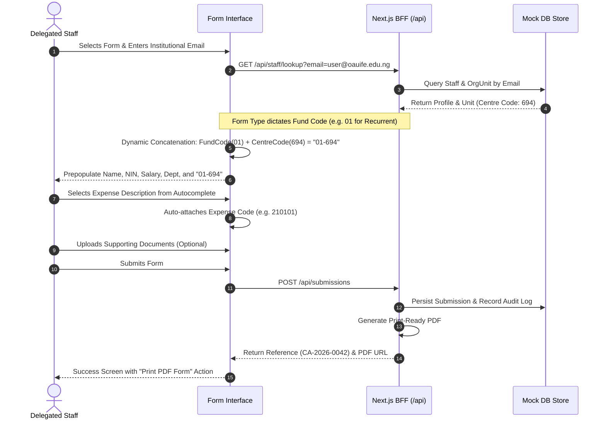

# Implementation Plan: BFF Architecture, Mock Database, University Staff Directory & Bursary Form Processing Workflow

## 1. Executive Summary & Revised Workflow Vision

This updated implementation plan aligns the **OAU Bursary Digital Form Submission & Processing System** with the updated operational workflow and institutional accounting structure established by the University Bursary Unit. 

### Key Architectural Shifts & Core Policies:
1. **Universal Staff Submission (No Fixed Representatives)**:
   - Organizational units do not depend on designated single representatives.
   - Any university staff member can be delegated by their department, faculty, directorate, division, or unit to complete and submit digital forms.
2. **Comprehensive Staff Directory & Instant Prepopulation**:
   - Complete university staff records are maintained centrally on the platform.
   - When a staff member logs in or enters their institutional email (`username@oauife.edu.ng`), the system immediately fetches and prepopulates all their verified credentials (Title, Full Name, Staff ID, NIN, Phone, Designation, Salary Type, Grade Level, Step, and affiliated Organizational Unit).
3. **Decoupled Fund Code & Centre Code (`01-694`)**:
   - **Centre Code** (e.g. `694`) is an intrinsic attribute of the **Organizational Unit** (department, faculty, unit, directorate).
   - **Fund Code** (e.g. `01` for Recurrent Vote, `02` for Capital Vote, `05` for Internally Generated Revenue/IGR) is applicable to the **Form / Funding Source**.
   - Upon form completion, the system dynamically concatenates the applicable Fund Code and the unit's Centre Code into the institutional accounting format: `FundCode-CentreCode` (e.g. `01-694`).
4. **Automated Print-Ready PDF & Universal Print Access**:
   - Upon digital submission, the platform generates an official, print-formatted PDF containing all auto-populated staff information, concatenated Fund & Centre Codes (`01-694`), itemized request breakdowns, expense codes, barcodes/QR codes, and physical endorsement signature blocks.
   - **Universal Print Functionality**: Printing and PDF download are accessible across **all** lifecycle interfaces:
     1. Post-Submission Success Screen (`/department/forms/[type]/success`).
     2. Submitting Staff / Department Details Page (`/department/submission/[id]`).
     3. Bursary Officer Review Details Page (`/bursary/submission/[id]`).
5. **Physical-to-Digital Processing Loop**:
   - After online submission, the staff member prints the official form, signs it, and obtains the signature/stamp of their Head of Unit.
   - The signed physical hard copy is delivered to the Bursary Unit.
   - Bursary officers cross-reference the physical hard copy with the online submission using the reference number.
6. **Streamlined 4-State Status Lifecycle**:
   $$\text{Submitted} \longrightarrow \text{In Review} \longrightarrow \text{Approved} \;\text{OR}\; \text{Rejected}$$
   - **`Submitted`**: Digital submission complete, PDF generated, awaiting physical delivery to Bursary.
   - **`In Review`**: Physical hard copy received at Bursary; officer actively verifying credentials, vote balances, and attachments.
   - **`Approved`**: Verified and approved. Officer enters optional approval notes and voucher/mandate allocation number.
   - **`Rejected`**: Disallowed or returned. Officer enters a **mandatory explanatory note**. Rejected submissions cannot be edited; they require a fresh submission.
7. **Single Unified Submissions Route for Bursary Portal**:
   - All submissions (regardless of status: Submitted, In Review, Approved, Rejected) are accessed via a single route: `/bursary/submissions`.
   - Features robust server-side search (by reference number, staff name, staff ID, department), filtering (status tabs/dropdown, form type, date range), and pagination.
8. **High-Performance Ingestion for ~4,000 Staff Records**:
   - To accommodate the full university workforce (~4,000 staff members) without browser UI freezing or server timeout errors, a client-chunked ingestion pipeline with a real-time progress bar, pre-validation reporting, and server-side $O(1)$ indexed validation is implemented.
9. **Triple Entity Single & Excel Bulk Management**:
   - Both individual creation and bulk Excel (`.xlsx`/`.csv`) onboarding are provided for:
     1. **University Staff Directory** (`~4,000` records).
     2. **Organizational Units** (Faculties, Departments, Directorates, Units, Divisions).
     3. **Expense Code Catalog** (Standard accounting classifications).
10. **Site-Wide Superadmin Audit Log**:
   - Every administrative, submission, review, and authentication event is immutably logged for governance.

```
┌────────────────────────────────────────────────────────────────────────────────────────┐
│                              RESPONSIVE PRESENTATION LAYER                             │
│  Superadmin Portal         │  Staff / Unit Portal           │  Bursary Processing      │
│  - Staff Mgmt (Single/Bulk)│  - Email Auto-population       │  - All Submissions Route │
│  - Org Units (Single/Bulk) │  - Fund/Centre Code (01-694)   │  - Server Search, Filter │
│  - Expense Codes (Bulk)    │  - Universal Print / PDF       │  - Physical Cross-Check  │
│  - Site-Wide Audit Logs    │  - My Submissions Table        │  - Approve/Reject + Note │
│  - Collapsible Sidebar     │  - Collapsible Sidebar         │  - Universal Print / PDF │
└───────────────────────────────────────────┬────────────────────────────────────────────┘
                                            │ HTTP / JSON (Search, Filter, Pagination)
┌───────────────────────────────────────────▼────────────────────────────────────────────┐
│                       BFF LAYER (Next.js 15 App Route Handlers)                        │
│   /api/auth/*     │   /api/staff/* (Chunked Ingestion)   │   /api/org-units/*          │
│   /api/expense-codes/*     │   /api/submissions/*        │   /api/pdf/generate/*       │
│   /api/fund-codes/*        │   /api/audit-logs/*                                       │
│  - @oauife.edu.ng Validation - Role & Route Guards - Zod Validation - Audit Dispatcher │
└───────────────────────────────────────────┬────────────────────────────────────────────┘
                                            │ Repository Interfaces
┌───────────────────────────────────────────▼────────────────────────────────────────────┐
│                            DATA ABSTRACTION LAYER                                      │
│  IStaffRepository │  IOrgUnitRepository │  IExpenseRepository │  ISubmissionRepository │
├────────────────────────────────────────────────────────────────────────────────────────┤
│  [NOW] In-Memory Mock Store with JSON snapshot persistence (.data/mock-db.json)         │
│  [LATER] PostgreSQL Adapter (Prisma / Drizzle / pg pool)                                │
└────────────────────────────────────────────────────────────────────────────────────────┘
```

---

## 2. Core Entities & Data Modeling

### 2.1 University Staff Directory (`StaffProfile` / `User`)
To enable instantaneous auto-fill on all forms, the system maintains comprehensive records of all university staff:
- **Institutional Email**: Primary identifier, strictly validated with regex `^[a-zA-Z0-9._%+-]+@oauife\.edu\.ng$`.
- **Fields**:
  - `id`: UUID
  - `title`: `'Prof.' | 'Dr.' | 'Mr.' | 'Mrs.' | 'Ms.' | 'Engr.' | 'Pharm.' | 'Arch.'`
  - `firstName`: string
  - `lastName`: string
  - `middleName?`: string
  - `fullName`: string (computed)
  - `staffId`: University Staff Payroll Number (e.g. `P.14205`)
  - `email`: Institutional email (`username@oauife.edu.ng`)
  - `phone`: Contact phone number (e.g. `08031234567`)
  - `designation`: Post on payroll (e.g. `Senior Lecturer`, `Principal Executive Officer`)
  - `nin`: National Identity Number (11 digits)
  - `salaryType`: Salary structure (`CONTISS` | `CONUASS` | `CONMESS` | `CONPASS` | `CONTOPS` | `CONRAISS`)
  - `salaryGrade`: Grade level (e.g. `CONTISS 08`, `CONUASS 05`)
  - `salaryLevel`: Numeric/alphanumeric level
  - `salaryStep`: Numeric step (e.g. `01` - `15`)
  - `orgUnitId`: Foreign key to `OrgUnit`
  - `role`: `'superadmin' | 'staff' | 'bursary'`
  - `bursaryUnit?`: (if `role === 'bursary'`) e.g. `'Audit' | 'Expenditure' | 'Treasury' | 'Advances' | 'Final Accounts'`
  - `status`: `'active' | 'inactive'`
  - `mustChangePassword`: boolean (defaults to `true` on creation)
  - `passwordHash`: Salted/hashed password string
  - `createdAt`, `updatedAt`

### 2.2 University Organizational Units (`OrgUnit`)
Models all faculties, departments, directorates, divisions, and units across the institution:
- **`unitType`**: `'faculty' | 'department' | 'directorate' | 'division' | 'unit'`
- **Fields**:
  - `id`: Unique string slug or UUID (e.g. `org-csc-dept`, `org-tech-fac`, `org-dict-dir`, `org-works-div`, `org-audit-unit`)
  - `name`: Full entity name (e.g. "Department of Computer Science and Engineering")
  - `code`: Short code (e.g. "CSC")
  - `type`: UnitType
  - `parentUnitId?`: Optional parent entity (e.g. Faculty of Technology for Department of Computer Science)
  - `centreCode`: 3-digit Centre Code assigned to this organizational unit (e.g. `"694"`, `"210"`, `"105"`)
  - `status`: `'active' | 'inactive'`
  - `createdAt`, `updatedAt`

> [!IMPORTANT]
> **Fund Code vs. Centre Code Separation**: The `centreCode` belongs directly to the `OrgUnit`. The `fundCode` is associated with the **Form / Funding Source** (e.g. Recurrent = `01`, Capital = `02`, Research Grant = `04`, IGR = `05`). When a staff member fills a form for their unit, the form's `fundCode` and unit's `centreCode` are dynamically concatenated to yield the combined institutional string `FundCode-CentreCode` (e.g. `01-694`).

### 2.3 Fund Code Catalog (`FundCode`)
Defines the standard university funding vote codes:
- `id`: UUID
- `code`: 2-digit Fund Code string (e.g. `"01"`, `"02"`, `"04"`, `"05"`, `"08"`)
- `name`: Fund source name (e.g. `"Recurrent Expenditure Vote"`, `"Capital Development Fund"`, `"TETFund / Research Grants"`, `"Internally Generated Revenue (IGR)"`)
- `description?`: Explanatory details for bursary classification
- `isDefault`: boolean (e.g. `01` is default recurrent vote for operational advances)
- `status`: `'active' | 'inactive'`

### 2.4 Expense Code Catalog (`ExpenseCode`)
Standardized accounting codes required on expenditure, purchase, and imprest forms:
- `id`: UUID
- `code`: Expense Code string (e.g. `"210101"`, `"210201"`, `"220101"`, `"220202"`, `"230101"`)
- `description`: Formal accounting description (e.g. `"Local Transport & Travels - Others"`, `"Office Stationeries & Computer Supplies"`, `"Maintenance of Motor Vehicles"`, `"Research Grants & Field Work"`)
- `category`: Classification group (e.g. `"Travel & Logistics"`, `"Supplies & Consumables"`, `"Repairs & Maintenance"`, `"Capital Project"`)
- `status`: `'active' | 'inactive'`
- `createdAt`, `updatedAt`

### 2.5 Form Submissions (`FormSubmission`)
Captures digital form data, auto-populated staff credentials, physical submission requirements, and review decisions:
- **Lifecycle Statuses**:
  - `'Submitted'`: Form submitted online, PDF generated, pending physical delivery to Bursary.
  - `'In Review'`: Physical copy received at Bursary; bursary staff actively verifying credentials and claims.
  - `'Approved'`: Submission approved by Bursary. Optional approval comment and voucher number allocated.
  - `'Rejected'`: Submission disallowed/rejected. Mandatory failure reason provided. Requires fresh submission.
- **Fields**:
  - `id`: UUID
  - `referenceNumber`: Unique tracking code (e.g. `CA-2026-0042`)
  - `formType`: `'cash-advance' | 'dlpo' | 'expenditure-authorization' | 'duty-mileage' | 'imprest-holder'`
  - `submittedByStaffId`: Staff ID of person who filled the form
  - `submittedByName`: Full name of delegated staff
  - `submittedByEmail`: Institutional email
  - `department`: Submitting unit name
  - `departmentId`: Submitting unit ID
  - `fundCode`: Form-specific Fund Code (e.g. `"01"`)
  - `centreCode`: Submitting unit Centre Code (e.g. `"694"`)
  - `formattedFundCentreCode`: Combined string: `"{fundCode}-{centreCode}"` (e.g. `"01-694"`)
  - `staffSnapshot`: Frozen copy of staff details at submission time (NIN, salary type, grade, level, step, title, designation)
  - `formData`: Form-specific payload (item descriptions, quantities, unit prices, total amounts, expense codes & descriptions)
  - `supportingDocuments`: Array of `{ id, fileName, fileSize, fileType, fileUrl, uploadedAt }`
  - `pdfUrl`: Path or data reference to generated PDF file
  - `status`: `'Submitted' | 'In Review' | 'Approved' | 'Rejected'`
  - `bursaryDecision`: `{ decision: 'Approved' | 'Rejected'; officerName: string; officerEmail: string; officerUnit: string; note: string; voucherNumber?: string; decidedAt: string }`
  - `submittedDate`: ISO timestamp
  - `processedDate?`: ISO timestamp

### 2.6 Site-Wide Audit Log (`AuditLog`)
Exclusively accessible to Superadmin for compliance and security auditing:
- `id`: UUID
- `actorId`: User ID
- `actorName`: Full name
- `actorEmail`: Institutional email (`@oauife.edu.ng`)
- `actorRole`: `'superadmin' | 'staff' | 'bursary'`
- `action`: Standardized event code:
  - `STAFF_REGISTERED`, `STAFF_BULK_UPLOADED`, `STAFF_UPDATED`, `STAFF_PASSWORD_RESET`
  - `ORG_UNIT_CREATED`, `ORG_UNIT_BULK_UPLOADED`, `ORG_UNIT_UPDATED`
  - `EXPENSE_CODE_CREATED`, `EXPENSE_CODE_BULK_UPLOADED`, `EXPENSE_CODE_UPDATED`
  - `FORM_SUBMITTED`, `FORM_PDF_PRINTED`, `FORM_STATUS_UPDATED`, `FORM_APPROVED`, `FORM_REJECTED`
- `entityType`: `'staff' | 'org_unit' | 'expense_code' | 'fund_code' | 'submission' | 'auth'`
- `entityId`: Target ID
- `details`: Human-readable summary & structured before/after diff
- `ipAddress`: Client IP
- `timestamp`: ISO timestamp

---

## 3. High-Volume Excel Bulk Ingestion Architecture (~4,000 Records)

Managing ~4,000 university staff records requires specialized ingestion handling to eliminate client-side UI freezing, memory exhaustion, and server request timeouts.

```mermaid
flowchart TD
    A[Superadmin selects 4,000-row Excel file] --> B[Client Web Worker / Async SheetJS Parser]
    B --> C[Instant Client-Side Schema Check: Headers, Mandatory Fields]
    C --> D[Display Ingestion Preview & Validation Summary]
    D -->|Click 'Start Ingestion'| E[Chunk Records into Batches of 250 - 500 Rows]
    E --> F[Send Batch 1 to /api/staff/bulk-upload/batch]
    F --> G[Server $O(1)$ Set/Map Lookup against Existing DB]
    G --> H[Batch Insert Valid Records & Append Audit Log]
    H --> I[Return Batch Result: successCount, errors]
    I --> J{More Batches?}
    J -->|Yes| K[Update UI Progress Bar: 12.5% ... 25% ... 100%]
    K --> E
    J -->|No| L[Display Ingestion Report: 3,982 Added, 18 Skipped]
    L --> M[Optionally Download Discrepancy / Error Excel Sheet]
```

### 3.1 Client-Side Non-Blocking Ingestion Pipeline
1. **Async Parsing (Web Worker / Chunked Loop)**:
   - File reading is performed off the main thread using an async reader or worker to avoid freezing the browser tab during binary decoding.
2. **Pre-Ingestion Validation Matrix**:
   - The UI parses the workbook and evaluates records against client rules:
     - Institutional email matches `^[a-zA-Z0-9._%+-]+@oauife\.edu\.ng$`.
     - Mandatory fields present: `staffId`, `firstName`, `lastName`, `email`, `nin`, `designation`, `salaryType`, `salaryGrade`.
     - Check for in-file duplicates (duplicate emails or staff IDs within the Excel file itself).
3. **Validation Summary Dashboard**:
   - Before any record touches the database, the superadmin views a real-time summary card:
     - **Total Rows Detected**: e.g. `4,012`
     - **Ready for Import**: e.g. `3,995`
     - **Invalid Rows (Format / Missing Fields)**: e.g. `12`
     - **Internal Duplicates**: e.g. `5`
   - A searchable preview table displays the parsed rows, with invalid rows highlighted in red with inline error tooltips.
4. **Chunked Sequential Dispatch**:
   - When the user clicks **"Commit Import"**, the client chunks the dataset into slices of 250 records.
   - Dispatches batches sequentially via `POST /api/staff/bulk-upload/batch`.
   - Renders a continuous animated progress bar (`Importing records 1,250 of 4,000 (31%)...`) with a graceful cancellation button.
5. **Error Discrepancy Export**:
   - Any rows rejected by the server or client validation can be exported directly into a downloadable Excel sheet: `OAU_Staff_Import_Errors.xlsx`, containing the original data plus an added `ErrorReason` column (e.g. *"Staff ID P.1102 already exists"* or *"Invalid email format: john@gmail.com"*).

### 3.2 Server-Side High-Performance Processing
1. **$O(1)$ Set & Map Indexing**:
   - Rather than executing $N$ database lookups ($4,000 \times 2 = 8,000$ queries), the server loads existing `staffId` and `email` sets into an in-memory hash set once per transaction.
   - Validation against existing records executes in $O(1)$ constant time per row.
2. **Batched Repository Insertion**:
   - The mock store / future database adapter performs a bulk array push or `prisma.staff.createMany()` in single transactions per chunk.
3. **Comprehensive Audit Dispatch**:
   - A single consolidated audit log entry is generated per bulk batch import (`STAFF_BULK_UPLOADED: Ingested batch 4 of 8 (250 records)`).

---

## 4. Single & Bulk Onboarding for Org Units & Expense Codes

### 4.1 Organizational Units Management (`/admin/org-units`)
- **Single Unit Creation**:
  - Modal/Form fields: Name, Code (e.g. `CSC`), Unit Type (`faculty | department | directorate | division | unit`), Parent Unit selector, and **Centre Code** (e.g. `694`).
- **Excel Bulk Upload (`/admin/org-units/upload`)**:
  - Template: `OAU_Org_Units_Template.xlsx` (Columns: `Name`, `Code`, `Type`, `CentreCode`, `ParentUnitCode`).
  - Validation preview table and batch commit.

### 4.2 Expense Codes Catalog Management (`/admin/expense-codes`)
- **Single Expense Code Creation**:
  - Modal/Form fields: Code (e.g. `210101`), Accounting Description, Category (e.g. `Travel & Logistics`).
- **Excel Bulk Upload (`/admin/expense-codes/upload`)**:
  - Template: `OAU_Expense_Codes_Template.xlsx` (Columns: `Code`, `Description`, `Category`).
  - Instant validation for duplicate code entries and batch commit.

---

## 5. Universal Print Functionality & PDF Generation Architecture

The university process mandates physical hard copies signed by the staff member and Head of Unit. Print capability must therefore be seamless and omnipresent.

```
┌────────────────────────────────────────────────────────────────────────────────────────┐
│                             UNIVERSAL PRINT & EXPORT MATRIX                            │
├──────────────────────────────┬─────────────────────────────┬───────────────────────────┤
│ 1. Post-Submission Screen    │ 2. Staff Details Page       │ 3. Bursary Review Page    │
│    (/forms/[type]/success)   │    (/department/sub/[id])   │    (/bursary/sub/[id])    │
├──────────────────────────────┼─────────────────────────────┼───────────────────────────┤
│ - Immediate "Print Form" CTA │ - Persistent Print button   │ - Persistent Print button │
│ - "Download PDF Copy"        │ - "Download Official PDF"   │ - "Download Official PDF" │
│ - Physical submission guide  │ - Inspection of stamp boxes │ - Hard-copy verification  │
└──────────────────────────────┴─────────────────────────────┴───────────────────────────┘
```

### 5.1 Official PDF Layout Specifications
The generated PDF strictly adheres to official university stationery standards:
1. **Header Block**:
   - Official Obafemi Awolowo University Crest (high-resolution monochrome/duotone).
   - "OBAFEMI AWOLOWO UNIVERSITY, ILE-IFE, NIGERIA"
   - "BURSARY DEPARTMENT"
   - Official Form Title (e.g. *"APPLICATION FOR CASH ADVANCE / IMPREST"*).
2. **Document Control & Barcode**:
   - Unique Reference Number (e.g. `CA-2026-0042`).
   - Digital submission timestamp and generated Code128 / QR barcode for rapid counter scanning at Bursary.
3. **Section A: Staff Particulars & Classification**:
   - Full Name (with Title), Staff ID, Official Designation.
   - National Identity Number (NIN), Contact Phone, Institutional Email.
   - Salary Structure: Type (`CONTISS`/`CONUASS`), Grade Level, Step.
   - Submitting Unit: Department / Faculty / Directorate.
   - **Combined Accounting Code**: Formatted **`FundCode-CentreCode`** (e.g. **`01-694`**).
4. **Section B: Request Details & Accounting Breakdown**:
   - Purpose / Justification of Request.
   - Itemized Schedule of Expenditure (Description, Quantity, Rate, Amount).
   - Expense Code & Description allocation (e.g. `210101 - Local Transport & Travels`).
   - Total Amount in figures ($\mathbf{N}$) and formal words (*"Two Hundred and Fifty Thousand Naira Only"*).
5. **Section C: Formal Physical Endorsement Blocks**:
   - **Box 1: Applicant Signature & Date**: Delegated staff signature line, date.
   - **Box 2: Head of Unit Endorsement**: Name, Signature, Official Rubber Stamp, Date.
   - **Box 3: Bursary Receiving & Internal Audit Stamp**: Physical receipt date, processing officer initial.
   - **Box 4: Final Bursary Approval & Voucher Allocation**: Bursar / Deputy Bursar Signature, Approved Amount, Voucher Number, Cheque/Mandate Reference, Date.

### 5.2 Print Execution Mechanisms
- **Direct Browser Print (`window.print()`)**:
  - Fully optimized `@media print` CSS stylesheet hiding navigation headers, sidebars, buttons, and footers.
  - Formats the page into crisp, high-contrast black-and-white standard A4 paper dimensions with proper page margins.
- **Server-Rendered Downloadable PDF (`GET /api/submissions/[id]/pdf`)**:
  - Produces an immutable, standalone `.pdf` binary file suitable for offline archiving, emailing, or reprinting from any device.

---

## 6. Smart Prepopulation Engine & Dynamic Fund/Centre Code Binding



---

## 7. Universal Collapsible Navigation & Server-Side Data Tables

### 7.1 Collapsible Sidebar (`AppSidebar`)
Uniform collapsible navigation across all user roles:
- **Desktop**: Expandable sidebar with logo, navigation links, badges, and user profile card. One-click toggle shrinks to a 64px compact icon-only rail with interactive hover tooltips.
- **Mobile / Tablet**: Responsive slide-out sheet drawer triggered by hamburger button in the sticky top bar.
- **Portal Navigation Routes**:
  - **Superadmin (`/admin/*`)**:
    - Dashboard (`/admin`)
    - Staff Directory (`/admin/staff`) - Single register + 4,000-row chunked Excel upload
    - Organizational Units (`/admin/org-units`) - Single create + Excel bulk upload
    - Expense Codes (`/admin/expense-codes`) - Single create + Excel bulk upload
    - Bursary Officers (`/admin/officers`)
    - Site-Wide Audit Logs (`/admin/audit-logs`)
  - **Staff / Department Portal (`/department/*`)**:
    - Available Forms (`/department/forms`)
    - My Submissions (`/department/submissions`)
    - Submission Details & Print (`/department/submission/[id]`)
  - **Bursary Portal (`/bursary/*`)**:
    - All Submissions (`/bursary/submissions`) - Single unified route for all submissions (Submitted, In Review, Approved, Rejected) with server-side search, status filters, and pagination
    - Submission Review, Print & Decision (`/bursary/submission/[id]`)

### 7.2 Server-Side Data Tables
Every tabular screen uses server-side querying:
`GET /api/<resource>?page=1&limit=10&search=<term>&status=<status>&sortBy=<field>&sortOrder=<asc|desc>`
- Fast in-memory / SQL pagination, case-insensitive search, and dynamic column sorting.

---

## 8. BFF API Route Specifications (Next.js App Router)

| Method | Endpoint | Description | Guard |
|---|---|---|---|
| **Auth** | | | |
| `POST` | `/api/auth/login` | Institutional email & password login | Public |
| `POST` | `/api/auth/logout` | Invalidate session | Authenticated |
| `GET` | `/api/auth/me` | Current user profile, role & password status | Authenticated |
| `POST` | `/api/auth/change-password` | Update password & clear `mustChangePassword` | Authenticated |
| `POST` | `/api/auth/reset-password` | Admin one-click reset for any staff member | Superadmin |
| **Staff Directory** | | | |
| `GET` | `/api/staff` | Server-side paginated list of staff members | Superadmin |
| `POST` | `/api/staff` | Register single staff member | Superadmin |
| `GET` | `/api/staff/lookup` | Look up staff & unit details by email | Authenticated |
| `PATCH`| `/api/staff/[id]` | Update staff attributes, designation, or salary | Superadmin |
| `POST` | `/api/staff/bulk-upload/validate` | Dry-run schema & duplicate check for Excel data | Superadmin |
| `POST` | `/api/staff/bulk-upload/batch` | Ingest batch chunk (250-500 rows) with $O(1)$ check | Superadmin |
| **Org Units** | | | |
| `GET` | `/api/org-units` | List units with Centre Codes | Authenticated |
| `POST` | `/api/org-units` | Create single organizational unit | Superadmin |
| `POST` | `/api/org-units/bulk-upload` | Batch-import organizational units via Excel | Superadmin |
| **Fund Codes** | | | |
| `GET` | `/api/fund-codes` | List available Fund Codes (01, 02, etc.) | Authenticated |
| **Expense Codes** | | | |
| `GET` | `/api/expense-codes` | Autocomplete / list of expense codes & descriptions | Authenticated |
| `POST` | `/api/expense-codes` | Create single expense code entry | Superadmin |
| `POST` | `/api/expense-codes/bulk-upload` | Batch-import expense codes via Excel | Superadmin |
| **Submissions** | | | |
| `GET` | `/api/submissions` | Server-side paginated & filtered submissions (supports status, search, unit, form type) | Authenticated |
| `POST` | `/api/submissions` | Submit form, capture staff snapshot, bind `01-694`, generate PDF | Staff / Authenticated |
| `GET` | `/api/submissions/[id]` | Full submission details, decision records, & PDF data | Owner / Bursary |
| `POST` | `/api/submissions/[id]/approve` | Approve submission with optional note & voucher | Bursary / Superadmin |
| `POST` | `/api/submissions/[id]/reject` | Reject submission with **mandatory reason note** | Bursary / Superadmin |
| `GET` | `/api/submissions/[id]/pdf` | Download official print-ready PDF binary | Authenticated |
| **Audit Logs** | | | |
| `GET` | `/api/audit-logs` | Server-side paginated site-wide audit records | Superadmin Only |

---

## 9. Mock Database & Repository Architecture

1. **Repository Interfaces** (`src/lib/server/db/interfaces/`):
   - `IStaffRepository`: `listPaginated`, `findById`, `findByEmail`, `create`, `update`, `bulkCreateBatch`.
   - `IOrgUnitRepository`: `list`, `findById`, `findByCode`, `create`, `update`, `bulkCreate`.
   - `IFundCodeRepository`: `list`, `findByCode`.
   - `IExpenseCodeRepository`: `list`, `findById`, `findByCode`, `search`, `create`, `update`, `bulkCreate`.
   - `ISubmissionRepository`: `listPaginated`, `findById`, `create`, `approve`, `reject`.
   - `IAuditLogRepository`: `create`, `listPaginated`.
2. **Mock Implementation with Seed Data** (`src/lib/server/db/mock/`):
   - 1 Superadmin: `admin@oauife.edu.ng`
   - 6 Bursary Officers across processing units (Audit, Expenditure, Advances, etc.).
   - 25 University Org Units with designated 3-digit Centre Codes (`694`, `210`, `105`, etc.).
   - 5 Standard University Fund Codes (`01` Recurrent, `02` Capital, `04` TETFund/Research, `05` IGR, `08` Special Grants).
   - 35 Standard University Expense Codes with formal descriptions.
   - 30 Pre-registered University Staff across diverse ranks with complete profiles and NINs.
   - Local JSON snapshot persistence (`.data/mock-db.json`) ensuring modifications survive server restarts.
3. **Seamless Future PostgreSQL Transition**:
   - Zero UI or BFF route modifications required when replacing mock repositories with Prisma or Drizzle ORM implementations.

---

## 10. Phased Implementation Roadmap

### Phase 1: Data Contracts, Schemas & Mock Database
- Install `xlsx` (SheetJS) and PDF generation dependencies.
- Update `src/types/index.ts` with updated models (`StaffProfile`, `OrgUnit` with `centreCode`, `FundCode`, `ExpenseCode`, `FormSubmission` with `fundCode`, `centreCode`, `formattedFundCentreCode`, `bursaryDecision`, `AuditLog`).
- Build in-memory mock store with seed data and snapshot persistence (`.data/mock-db.json`).

### Phase 2: BFF Route Handlers (`src/app/api/...`)
- Implement `/api/auth/*` routes with `@oauife.edu.ng` validation and password enforcement.
- Implement `/api/staff/*` (lookup by email, single creation, and chunked batch upload).
- Implement `/api/org-units/*` (single creation, Excel bulk upload, listing with Centre Codes).
- Implement `/api/fund-codes` and `/api/expense-codes/*` (single create, Excel bulk upload, autocomplete search).
- Implement `/api/submissions/*` (submission creation, approval with optional notes, rejection with mandatory reasons, PDF generation).
- Implement `/api/audit-logs` (superadmin-only).

### Phase 3: Universal Collapsible Navigation & Layouts
- Build responsive `AppSidebar` with expand/collapse toggle and mobile drawer.
- Integrate into Superadmin (`/admin`), Staff (`/department`), and Bursary (`/bursary`) route groups.

### Phase 4: High-Performance Bulk Upload Portals (~4,000 Records)
- Build Staff Directory Manager (`/admin/staff`) with single registration form and chunked Excel bulk upload wizard (progress bar, pre-validation summary, discrepancy error download).
- Build Org Units Manager (`/admin/org-units`) with single form and Excel bulk upload.
- Build Expense Codes Manager (`/admin/expense-codes`) with single form and Excel bulk upload.
- Build Site-Wide Audit Log viewer (`/admin/audit-logs`).

### Phase 5: Smart Form Prepopulation & Dynamic `01-694` Binding
- Update all 5 forms (Cash Advance, DLPO, Expenditure Auth, Duty Mileage, Imprest Holder):
  - Email lookup triggering instant profile auto-fill (Name, Staff ID, NIN, Salary details, Department).
  - Dynamic concatenation of form's Fund Code (e.g. `01`) and unit's Centre Code (e.g. `694`) to produce `01-694`.
  - Expense Code searchable autocomplete selector.
  - Multi-file supporting document drag-and-drop.

### Phase 6: Universal Print Functionality & PDF Generation
- Implement official university PDF template (crest, barcode, staff particulars, `FundCode-CentreCode`, request items, 4 physical signature blocks).
- Implement print buttons and `@media print` styling on:
  1. Submission confirmation screen (`/department/forms/[type]/success`).
  2. Staff submission details page (`/department/submission/[id]`).
  3. Bursary review details page (`/bursary/submission/[id]`).

### Phase 7: Bursary Review Portal (Single Unified Submissions Route & Review Workflow)
- Build a single unified submissions route (`/bursary/submissions`) displaying all submissions across all statuses (`Submitted`, `In Review`, `Approved`, `Rejected`), featuring server-side search (by reference number, staff name, staff ID, department), filtering (by status tabs/dropdown, form type, date), and pagination.
- Bursary review detail page (`/bursary/submission/[id]`):
  - Cross-check physical hard copy against digital details.
  - Action modal: "Approve Submission" with optional note and voucher number.
  - Action modal: "Reject Submission" with **mandatory rejection reason note**.
  - Persistent Print & Download PDF buttons.

### Phase 8: Verification & Quality Assurance (Completed)
- `pnpm tsc --noEmit` verified with 0 errors.
- `pnpm build` verified with all 43 routes compiling cleanly.

### Phase 9: Session Navigation & Logout Hardening (Completed)
- **Problem**: Superadmin logout caused the UI to stay stuck on an infinite spinning loader instead of navigating to the homepage or login page, while dev server logged successful `POST /api/auth/logout 200` and `GET / 200`.
- **Root Cause**: `ProtectedRoute` rendered an uninformative loading spinner as soon as `session` became `null`, while conflicting concurrent client router transitions (`router.replace('/')` in `ProtectedRoute` and `router.push('/')` in the layout's logout handler) raced against Next.js 15 App Router server-side page compilation.
- **Resolution**:
  1. Updated `AuthContext.tsx`: `logout(redirectTo = '/')` performs a top-level `window.location.replace(redirectTo)`, ensuring clean cache clearing, reliable unmounting, and immediate navigation without race conditions.
  2. Hardened `ProtectedRoute.tsx`: Added `redirectedRef` to guard against duplicate redirect dispatching, switched to `window.location.replace()` with contextual login destinations (`/admin-login`, `/bursary-login`, `/department-login`), and added descriptive progress feedback text (`"Redirecting..."` / `"Verifying session..."`).
  3. Cleaned `handleLogout` across all layouts (`AdminLayout`, `BursaryDashboardLayout`, `DepartmentDashboardLayout`) to await `logout('/')` directly.
